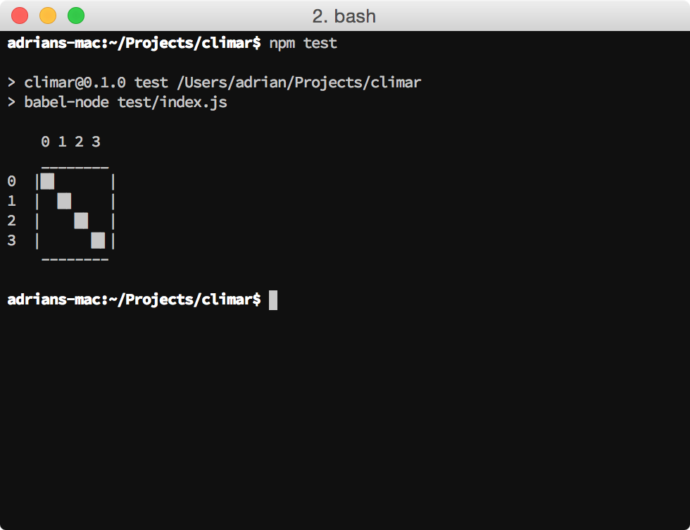

# Climar

The Command Line Image Renderer




## Installation

```sh
npm install --global climar
```


## Usage

```sh
Usage: /usr/local/bin/climar-dev [options] <file-to-render>

Options:
  --scale, -s     Scale the size of a pixel                         [default: 1]
  --colorize, -c  Render the image in color (turned of in TTYs)
                                                       [boolean] [default: true]

A file to be rendered must be specified!
```


## Related

Extensive overview:
[A Comparison of Image to ASCII Conversion Tools](
  https://www.xkyle.com/A-Comparison-of-Image-to-ASCII-Conversion-Tools/)

- [catpix] - Printing images in the terminal with 9 lines of Ruby.
- [Drawille] - Pixel graphics in terminal with unicode braille characters.
- [Fabulous] - Print images, colors, and stylish text to the terminal with Python.
- [Pixterm] - Draw images in an ANSI terminal with true color (Go).
- [Pxl] - Go tool to display images in the terminal.
- [TerminalImageViewer] - Java program to display images in a terminal using RGB ANSI codes and unicode block characters.
- [TEXTFLIX] - Renders Netflix to the terminal in ASCII-art form.
- [tv] - Quickly view (satellite) imagery in the terminal using Unicode 9.0 characters and true color (Python).
- [typo-image] - Image plugin for typo to draw images on the command line (JavaScript).
- [Viu] - Terminal image viewer with native support for iTerm and Kitty.

[catpix]: https://radek.io/posts/catpix/
[Drawille]: https://github.com/asciimoo/drawille
[Fabulous]: https://jart.github.io/fabulous
[Pixterm]: https://github.com/eliukblau/pixterm
[Pxl]: https://github.com/ichinaski/pxl
[TerminalImageViewer]: https://github.com/stefanhaustein/TerminalImageViewer
[TEXTFLIX]: https://github.com/JEphron/TEXTFLIX
[tv]: https://github.com/daleroberts/tv
[typo-image]: https://github.com/kaelzhang/typo-image
[Viu]: https://github.com/atanunq/viu
